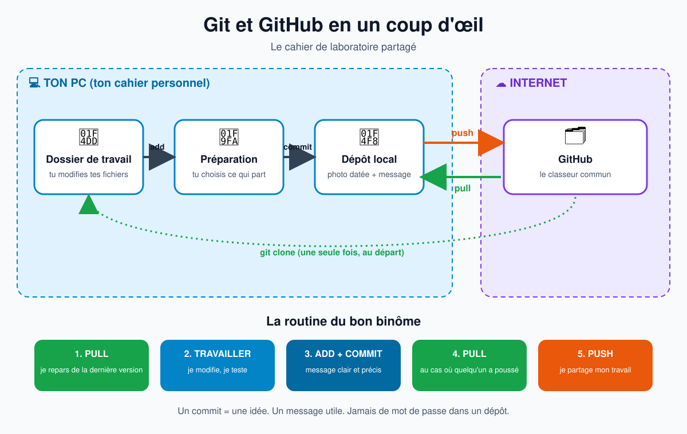
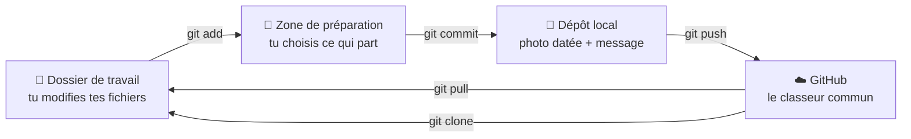

# Git et GitHub en un coup d'œil

> Infographie pédagogique pour comprendre la gestion de configuration. Analogie fil rouge : **le cahier de laboratoire partagé**.



## 1. L'analogie du cahier de laboratoire

| Dans la vraie vie | Dans Git |
|---|---|
| Le classeur commun de la salle de TP | Le dépôt distant (GitHub) |
| Ton cahier personnel | Ton dépôt local (sur ton PC) |
| La page sur laquelle tu écris | Ton dossier de travail |
| Les pages que tu mets de côté pour les photographier | La zone de préparation (staging) |
| Une photo datée avec un petit mot explicatif | Un commit |
| Poser tes nouvelles pages dans le classeur commun | Un push |
| Récupérer les pages ajoutées par les autres | Un pull |

## 2. Le circuit complet



## 3. Les cinq commandes à retenir

| Commande | Ce qu'elle fait | Phrase à retenir |
|---|---|---|
| `git clone` | Copie un dépôt GitHub sur ton PC | « Je photocopie le classeur commun » |
| `git add` | Prépare les fichiers à enregistrer | « Je choisis les pages à photographier » |
| `git commit -m "message"` | Enregistre une version dans ton historique local | « Je prends la photo et j'écris la date et le motif » |
| `git push` | Envoie tes commits vers GitHub | « Je dépose mes pages dans le classeur commun » |
| `git pull` | Récupère les commits des autres | « Je regarde ce que les autres ont ajouté » |

## 4. La routine du bon binôme

1. **Pull** avant de commencer : je repars de la dernière version.
2. Je travaille, je teste.
3. **Add** puis **commit** avec un message clair : « Ajout du filtre passe-bas ».
4. **Pull** encore une fois, au cas où quelqu'un a poussé entre-temps.
5. **Push** : je partage mon travail.

## 5. Les bons réflexes

- **Un commit = une idée.** Petit et clair vaut mieux que gros et flou.
- **Un message utile** : « Corrige la valeur de R2 » plutôt que « modif ».
- **Jamais de mot de passe** ni de clé dans un dépôt.
- **En cas de conflit** : deux personnes ont modifié la même ligne. Git ne devine pas, c'est à vous de choisir ensemble.

## 6. Mini-jeu : le cahier qui voyage

Par binômes, chaque étudiant a son « cahier » (une feuille) et le binôme partage un « classeur » (une pochette).

1. L'étudiant A écrit une ligne, la date et un message : c'est un **commit**.
2. Il glisse sa feuille dans la pochette : c'est un **push**.
3. L'étudiant B récupère la feuille de A : c'est un **pull**.
4. Les deux modifient la même ligne en même temps : c'est un **conflit**, à résoudre à voix haute.

## 7. Aide-mémoire visuel

```text
  TON PC                                  INTERNET
┌──────────────────────────────────┐    ┌────────────┐
│ Dossier  --add-->  Staging       │    │            │
│ de travail           |           │    │   GitHub   │
│                    commit        │    │            │
│                      v           │    │            │
│               Dépôt local  ==push==>   │            │
│                      ^           │    │            │
│                      +=====pull=====<  │            │
└──────────────────────────────────┘    └────────────┘
```
